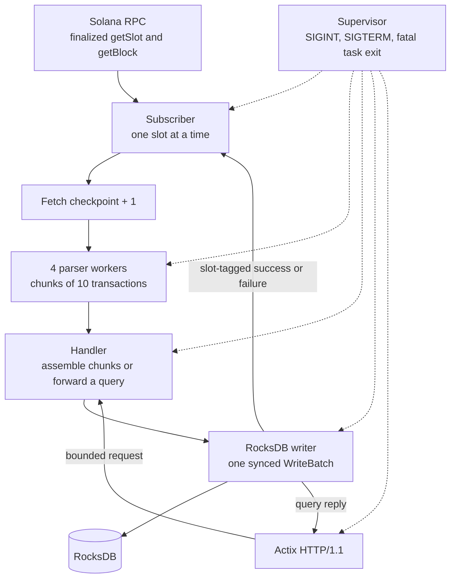

# Solana Aggregator

Solana Aggregator is an off-chain Rust service that indexes finalized Solana blocks and serves selected transaction and account observations over HTTP.

It is not an on-chain program, an Anchor contract, a validator, or a full blockchain explorer. It does not backfill history before the finalized slot it observes on first start.

## Key engineering features

- Decodes legacy, v0, and v1 transactions, with `maxSupportedTransactionVersion` set to 1.
- Indexes each transaction by its canonical first signature.
- Decodes supported System Program transfer instructions.
- Resolves v0 address-lookup-table accounts when the block metadata includes the loaded addresses.
- Stores post-transaction account balances as exact `u64` lamports.
- Retries transient `getBlock` failures and treats authoritative skipped slots separately from failures.
- Runs four parser workers with bounded channels, so a slow stage applies backpressure instead of growing without limit.
- Persists a block, its signature index, balance observations, and the slot checkpoint in one synced RocksDB batch.
- Restarts from the stored checkpoint plus one.
- Validates HTTP parameters and returns JSON errors.
- Exposes `/health` and `/status`.
- Shuts down the subscriber, parser workers, handler, database worker, and HTTP server together, and redacts credential-bearing URL fields in application errors.

## Architecture



The subscriber keeps one nonblocking Solana RPC client and asks for the finalized tip. It fetches only the next slot after `last_processed_slot`. A fetched block is split into chunks of 10 transactions and parsed by at most four workers. The handler assembles those chunks, or forwards an HTTP read, to the database worker. The database worker writes with `set_sync(true)` and reports that slot's success or failure. The subscriber advances only after the matching acknowledgment.

RocksDB holds:

- `BlockNo{height}` records, including transaction records and observed post-balances.
- Signature keys that point at a block height.
- `lst_blk_no`, the latest contiguous indexed block height.
- `last_processed_slot`, the durable resume boundary.
- The storage marker `canonical-signature-v2`.

A slot and a block height are different numbers. An authoritative skip advances the slot checkpoint and does not create a block. HTTP reads do not call Solana RPC.

## Prerequisites

- Rust and Cargo. This repository was built and tested with rustc 1.98.1.
- A C/C++ toolchain. The `rocksdb` 0.22 crate compiles RocksDB 8.10.0 through `librocksdb-sys`.
- A Solana RPC endpoint that accepts finalized `getSlot` and `getBlock` with `maxSupportedTransactionVersion: 1`. The default is public Devnet.

## Build and run

```bash
cargo build --locked
cargo test --locked
cargo run --locked -- \
  --chain-url https://api.devnet.solana.com \
  --db-url /tmp/solana-aggregator-example \
  --port-no 9944
```

`--chain-url` / `-s` selects the RPC endpoint. An explicit flag overrides `SOLANA_RPC_URL`. When neither is set, the endpoint is `https://api.devnet.solana.com`. `--db-url` / `-d` is the RocksDB directory; pass a writable path of your own instead of relying on the built-in default. `--port-no` defaults to `9944`.

The process listens on `127.0.0.1`. The database directory must be writable. An existing database with an incompatible storage marker, or indexed data and no `last_processed_slot`, is refused and is not migrated.

Do not put an API key in the command line of a shared transcript. If an endpoint needs one, pass it with `SOLANA_RPC_URL` or `--chain-url`. Application errors redact userinfo and query secrets such as `api-key` in URLs they format. That redaction does not cover every log line a dependency might emit, or the process environment.

Stop the process with Ctrl+C or SIGTERM. Intentional shutdown exits 0. An unrecoverable subscriber, handler, database, or HTTP failure exits 1 after the same coordinated shutdown. The shutdown budget for the in-flight slot and HTTP server is 10 seconds. The database worker can use up to another 10 seconds to finish a synced write.

## HTTP API

The server speaks HTTP/1.1. A database call that does not return within 5 seconds becomes HTTP 504. Error bodies look like `{"error":"..."}`.

| Status | When |
| --- | --- |
| 400 | Invalid block number, signature, address, range, or `block_no` query |
| 404 | Block, transaction, or account observation is absent |
| 500 | Stored data is corrupt or another storage failure occurs. The body does not include the database path |
| 503 | Nothing has been indexed yet, or the database worker is unavailable |
| 504 | The database worker did not answer within 5 seconds |

`/block_range/{start}/{end}` accepts at most 100 block heights, counted inclusively.

### `GET /health`

Returns 200 while the indexer is starting, indexing, or caught up with the finalized tip. Waiting for a new finalized slot is healthy. Returns 503 while shutting down or after a required worker has failed.

```bash
curl -sS http://127.0.0.1:9944/health
```

```json
{"status":"healthy"}
```

### `GET /status`

Reads in-memory indexer state. It does not call RPC and does not scan RocksDB.

```bash
curl -sS http://127.0.0.1:9944/status
```

```json
{
  "state": "indexing",
  "last_processed_slot": 520762051,
  "last_indexed_block_height": 507900234,
  "last_observed_finalized_slot": 520762137,
  "last_successful_processing_time": 1794318345009,
  "error": null
}
```

`state` is `starting`, `indexing`, `caught_up`, `stopping`, or `failed`. `last_processed_slot` is the checkpoint, not a block height. `last_indexed_block_height` is null until a block has been stored. `last_successful_processing_time` is Unix milliseconds. `error` is a sanitized fatal message, or null. The numbers above are from the 10 November 2026 Devnet run recorded at the bottom of this file.

### `GET /latest_block`

Returns a JSON array of the latest indexed block height and that block. Before any block is stored the response is 503 `{"error":"No block has been indexed yet"}`.

```bash
curl -sS http://127.0.0.1:9944/latest_block
```

The block object contains `tx_map` and `account_map`. `account_map` values are lamports.

### `GET /block_details/{block_no}`

```bash
curl -sS http://127.0.0.1:9944/block_details/507900234
```

A missing height is 404 `{"error":"Block not found"}`. A non-numeric height is 400 `{"error":"Invalid block number"}`.

### `GET /tx_details/{transaction_id}`

```bash
curl -sS http://127.0.0.1:9944/tx_details/48e4ctBT259ZXAYWfTin7WswJNhJgEV5Pj4tjfz212pXRNvQA7vjkQGBmR9r4Pa4TTGVPQECiquAbQBPGfKdSEyW
```

A successful body has `instruction` and `metadata`. `instruction` lists decoded System Program transfers as `["Transfer", from, to, sol_amount]`. `metadata` is the stored transaction status JSON, including fee and balances. An invalid signature string is 400. A well-formed signature that was not indexed is 404.

`sol_amount` is a floating-point SOL value derived from lamports. It is not a lossless encoding of every `u64` amount. The lamport post-balances in `account_map` and in transaction metadata are exact.

### `GET /block_range/{start}/{end}`

```bash
curl -sS http://127.0.0.1:9944/block_range/507900234/507900234
```

The body is a JSON object keyed by block height. Heights with no stored block are omitted, so a valid empty range is `{}`. `start` greater than `end` is 400. A span longer than 100 heights is 400 `{"error":"Block range exceeds 100 blocks"}`.

### `GET /account_balance/{address}`

```bash
curl -sS "http://127.0.0.1:9944/account_balance/1268xvRu969H2X5B1NMYKFGTMatAvHdW5tvUjGj5gREb?block_no=507900234"
```

The body is a JSON number of lamports. For the sample above, the indexed value was `5201920`. Omitting `block_no` uses the latest indexed height. An observed balance of `0` stays `0`. An address with no observation in that block is 404 `{"error":"Account observation not found"}`. An invalid address or `block_no` is 400.

These balances are post-transaction observations from indexed blocks. They are not a complete historical account ledger.

## Persistence and recovery

`last_processed_slot` is the slot the indexer will not fetch again. On a fresh database the process stores the finalized tip it just observed. That value is a starting boundary. Slots at or below it are not claimed as indexed, and `last_indexed_block_height` stays null until a block is stored.

The next run reads that checkpoint and fetches `checkpoint + 1`. A successful block write and the checkpoint update are in the same synced batch. An authoritative skipped slot advances only the checkpoint. A failed fetch or a failed write leaves the checkpoint unchanged so the slot can be retried. This is not exactly-once execution: a crash after a durable write and before the in-memory acknowledgment is recovered from the checkpoint, not by rewriting the block.

The storage format marker is `canonical-signature-v2`. An older or unknown marker, or indexed records without a checkpoint, is rejected. Use a new directory, or reindex explicitly in a future tool. This process will not migrate or delete that data.

## Testing

```bash
cargo check --locked
cargo test --locked
cargo clippy --locked --all-targets
cargo fmt --check
cargo audit
```

`cargo test --locked` currently runs 152 tests. They cover legacy, v0, and v1 decoding, address-lookup-table resolution, System Program transfer decoding, exact lamport storage, signature indexes, atomic writes, checkpoint restart, skipped slots, bounded parser concurrency, HTTP success and error responses, `/health`, `/status`, credential redaction, corrupt stored records, and shutdown behavior. The tests do not call a live Solana RPC.

`cargo clippy --locked --all-targets` still reports six existing warnings: a manual character comparison in `src/error.rs`, two unused `enumerate` indexes and two `to_string` debug arguments in `src/parser.rs`, and a map iteration in `src/util.rs`.

`cargo audit` 0.22.2 reports no vulnerabilities against the current lockfile. It still warns that `adler`, `ansi_term`, `atty`, `bincode`, `paste`, `proc-macro-error`, and `structopt` are unmaintained, and that `atty` and `rand` 0.8.5 have unsoundness advisories. The `rand` 0.8.5 note applies when a logger calls `rand::rng()` while logging; this service's logger does not. Those crates remain because the Solana 4.4.1 graph or the CLI still uses them.

## Current limitations

- Indexing starts at the finalized tip observed on first open. Earlier slots are not backfilled.
- Slots are processed one at a time, even though each block is parsed by four workers.
- Only supported System Program transfer instructions are decoded. Inner instructions and SPL token transfers are not decoded as transfers.
- Transfer amounts in JSON are floating-point SOL values, so they are not lossless for every lamport amount.
- Account balances are observed post-transaction values from indexed blocks, not a complete account history.
- There is no exactly-once guarantee.
- Public Devnet can rate-limit or fail `getBlock`. Retryable failures stop the indexer rather than skipping the slot. Authoritative skipped-slot errors advance the checkpoint.
- An incompatible existing database is not migrated.
- The HTTP server is HTTP/1.1 only. HTTP/2 is disabled because the Actix HTTP/2 stack available here still depended on a vulnerable `h2` 0.3 release.
- Dependency-audit warnings listed above remain.

## Security

Public Devnet does not need a private credential. A private RPC URL can be supplied with `--chain-url` or `SOLANA_RPC_URL`. The CLI hides the environment value in its help output. Application error display and debug text redact URL userinfo and query secrets, including `api-key`. `/health` and `/status` do not include the RPC URL, credentials, or the database path. HTTP 500 bodies use a fixed message.

This does not mean a dependency, a debugger, or the process environment cannot expose a secret.

The latest `cargo audit` result for this lockfile is zero vulnerabilities and the warnings listed under Testing.

## Devnet verification

These values are from one local run on 10 November 2026 against public `https://api.devnet.solana.com`. They are not a standing deployment and will not match a later run.

The database was a new directory, `/tmp/solana-agg-final-23`, on port 9964.

- Startup stored the finalized tip **520762039** as the initial checkpoint. That slot was not indexed.
- The first stored block was slot **520762040**, height **507900223**.
- A later indexed sample was slot **520762051**, height **507900234**.
- Signature `48e4ctBT259ZXAYWfTin7WswJNhJgEV5Pj4tjfz212pXRNvQA7vjkQGBmR9r4Pa4TTGVPQECiquAbQBPGfKdSEyW` was present in that block. `GET /tx_details/...` returned 200. Direct Devnet `getTransaction` for the same signature returned slot 520762051, version `legacy`, fee 5000, and `err: null`.
- `GET /account_balance/1268xvRu969H2X5B1NMYKFGTMatAvHdW5tvUjGj5gREb?block_no=507900234` returned `5201920`.
- `/health` returned 200 `{"status":"healthy"}`.
- `/status` reported `indexing`, checkpoint 520762051, and block height 507900234.
- Invalid signature, missing block 1, and a 200-height range returned 400, 404, and 400 respectively.
- SIGTERM exited 0. The last durable block in that shutdown was slot **520762055**, height **507900238**.
- Restart logged `Loaded checkpoint slot 520762055` and continued at slot **520762056**. The signature above was still readable. Logs from the shutdown did not contain an application channel-closed failure or an API key.

No live v1 transaction was identified in this sample. Legacy, v0, and v1 decoding remain covered by the automated tests.
