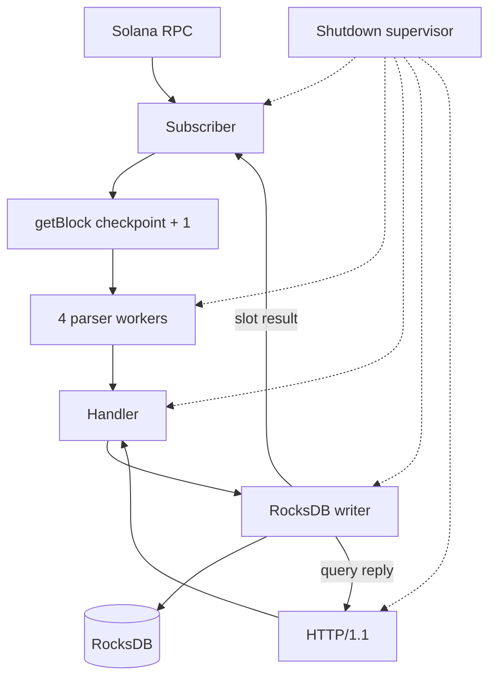

# Solana Aggregator

[](https://github.com/ayushmishra2005/Solana-Aggregator/actions/workflows/ci.yml)

Off-chain Rust indexer for finalized Solana blocks. It stores transactions, System Program transfers, and post-transaction account balances in RocksDB and serves them over HTTP. It is not an on-chain program or a full explorer.

## Capabilities

- Finalized `getSlot` / `getBlock` through one nonblocking RPC client, with `maxSupportedTransactionVersion: 1` (legacy, v0, and v1).
- Four parser workers and bounded channels. A slow stage blocks the producer instead of allocating without limit.
- Canonical first-signature index. V0 address-lookup-table accounts are resolved from the block's loaded addresses.
- System Program transfers keep the exact `u64` lamport amount. The historical SOL field is still present and is not exact above 2^53 lamports.
- One synced RocksDB batch writes the block, signature index, balances, and `last_processed_slot`.
- Restart reads that checkpoint and fetches the next slot. An existing checkpoint is never replaced by `--start-slot`.
- HTTP/1.1 API with parameter checks, one 5 second request deadline, and a 100-height range cap.
- SIGINT and SIGTERM drain the in-flight slot, then stop the workers. A fatal task exit uses the same shutdown and returns status 1.

## Architecture



The subscriber processes one slot at a time. Each block is split into chunks of 10 transactions. The writer acknowledges the slot only after the synced batch succeeds. HTTP reads go through the handler to that same writer and do not call RPC.

RocksDB keys are `BlockNo{height}`, the canonical signature, `lst_blk_no`, `last_processed_slot`, `last_produced_slot`, `solana_genesis_hash`, and the marker `canonical-signature-v2`. A slot is not a block height. A fresh database records the finalized tip, or `--start-slot` minus one, as a boundary and stores the RPC genesis hash. A restart against a different genesis hash is refused. A checkpoint without a genesis hash is also refused and is not given one. That boundary slot itself is not indexed.

## Stack

Rust 2021, Tokio, `solana-client` 4.4.1, RocksDB 0.22 (built from the bundled 8.10.0 sources), Actix Web 4.19 without HTTP/2.

## Quick start

Rust and Cargo. This tree is developed with rustc 1.98.1. RocksDB 8.10.0 is compiled from the bundled sources, so the build also needs a C compiler, `pkg-config`, and `clang`. On Ubuntu that is `build-essential`, `pkg-config`, and `clang`. On macOS it is the Xcode command-line tools.

```bash
cargo build --locked
cargo test --locked
cargo run --locked -- \
  --chain-url https://api.devnet.solana.com \
  --db-url /tmp/solana-aggregator-example \
  --port-no 9944
```

`--chain-url` / `-s` overrides `SOLANA_RPC_URL`. If neither is set, the endpoint is public Devnet. `--db-url` / `-d` is the RocksDB directory. The default is `solana-agg-db` in the current working directory. `--port-no` defaults to `9944` and binds `127.0.0.1`.

`--start-slot N` on an empty database sets the checkpoint to `N - 1`, so the first fetch is slot `N`. `N` must be at least 1. If the database already has a different checkpoint, startup exits and leaves that checkpoint in place. An incompatible storage marker, or indexed data without a checkpoint, is also refused and is not rewritten.

When the indexer has reached the finalized tip it waits one second before calling `getSlot` again. Shutdown interrupts that wait. Transient RPC failures (timeouts, connection errors, HTTP 429) are retried, three attempts at a time, then the same slot is tried again after one second. The checkpoint does not move. A definitive `getBlock` error stops the process. JSON-RPC `-32007` is not treated as a skipped slot by itself: the checkpoint moves only when a later finalized block's parent slot shows that the candidate was not produced. Otherwise the same slot is retried.

Ctrl+C or SIGTERM finishes the current slot when it can, then stops the HTTP server and workers. Shutdown of the slot and HTTP server is bounded to 10 seconds. The database worker may take another 10 seconds to finish a synced write.

## HTTP API

Errors are `{"error":"..."}`. Statuses: 400 invalid input, 404 missing block, transaction, or account observation, 500 storage failure, 503 nothing indexed yet or the database worker is down, 504 the request deadline expired. That 5 second deadline covers waiting for handler capacity, the database worker, and its reply.

`/tx_details/{signature}` looks up the canonical first signature. The index stores the block height of that transaction, and the response is the transaction record stored in that block. Account balances are the post-balances observed for accounts in an indexed block, including an observed `0`, carried forward from the previous indexed height. They are not a reconstructed account history. `/block_range/{start}/{end}` includes at most 100 heights.

```bash
curl -sS http://127.0.0.1:9944/health
curl -sS http://127.0.0.1:9944/status
curl -sS http://127.0.0.1:9944/latest_block
curl -sS http://127.0.0.1:9944/block_details/507900234
curl -sS http://127.0.0.1:9944/tx_details/48e4ctBT259ZXAYWfTin7WswJNhJgEV5Pj4tjfz212pXRNvQA7vjkQGBmR9r4Pa4TTGVPQECiquAbQBPGfKdSEyW
curl -sS http://127.0.0.1:9944/block_range/507900234/507900234
curl -sS "http://127.0.0.1:9944/account_balance/7twHjgLpUM94tqLvW8LcxQGMPQcfV9XNbsgctPqYqJhb?block_no=507900234"
```

`/health` is `{"status":"healthy"}` while starting, indexing, or waiting for a new finalized slot, and 503 while stopping or after a required worker fails.

`/status` reports `state`, `last_processed_slot`, `last_indexed_block_height`, `last_observed_finalized_slot`, `last_successful_processing_time`, and `error`. The slot and the height are different fields. The height is null until a block has been stored.

A transaction body is `{ "instruction": [...], "metadata": "..." }`. A newly decoded System Program transfer is:

```json
{"Transfer":["<source>","<destination>",<sol>,<lamports>]}
```

`<lamports>` is the exact integer. `<sol>` is `lamports / 1_000_000_000` as a float and is not exact for every integer. Records stored before the lamport field exist as a three-element array and still load.

`/latest_block` is `[height, block]`. The block has `tx_map` and `account_map`. A range body is an object keyed by height, or `{}` when none of those heights are stored.

## Devnet

Indexed from public Devnet. Explorer block URLs use the slot, not the block height.

- [Transaction `48e4ctBT…SEyW`](https://explorer.solana.com/tx/48e4ctBT259ZXAYWfTin7WswJNhJgEV5Pj4tjfz212pXRNvQA7vjkQGBmR9r4Pa4TTGVPQECiquAbQBPGfKdSEyW?cluster=devnet) in slot [520762051](https://explorer.solana.com/block/520762051?cluster=devnet), block height 507900234.
- `getTransaction` for that signature returns the same slot, version `legacy`, fee 5000, and `err: null`. The local API returns that signature from `/tx_details` and the block from `/block_details/507900234`.
- `GET /account_balance/7twHjgLpUM94tqLvW8LcxQGMPQcfV9XNbsgctPqYqJhb?block_no=507900234` returns `11318240` lamports. That is the post-balance of the second account in the transaction above, not a balance carried forward from an earlier height.

```bash
curl -sS http://127.0.0.1:9944/tx_details/48e4ctBT259ZXAYWfTin7WswJNhJgEV5Pj4tjfz212pXRNvQA7vjkQGBmR9r4Pa4TTGVPQECiquAbQBPGfKdSEyW
```

There is no hosted API. Run the binary locally against your own database directory.

## Testing

```bash
cargo fmt --all -- --check
cargo check --locked
cargo clippy --locked --all-targets -- -D warnings
cargo test --locked
cargo build --locked
cargo audit
```

The suite covers decoding, lookup tables, signature indexes, atomic checkpoint writes, restart, confirmed skipped slots, corrupt records, HTTP errors, shutdown, the optional start slot, and transport retries that stay on the same slot. Tests do not call a live RPC. CI runs those commands on GitHub Actions for `main` and pull requests with rustc 1.98.1. `cargo audit` fails on vulnerabilities. It still reports unmaintained crates (`structopt`, `bincode`, and others pulled in by the Solana 4.4.1 graph) and the `rand` 0.8.5 unsoundness warning, which applies when a logger calls `rand::rng()` while logging.
